<div align="center">

# ⚔️ LiteCode

[中文](README.md) · **English**

**An AI employee that lives on your own machine.** Web, terminal, WeChat and WeCom share one brain. It writes code, researches, makes documents and videos, runs pipelines and scheduled jobs, and can drive your Windows PC and your servers directly. Bring any OpenAI-compatible model (including your own). No credits, no subscription, your data stays home.

     

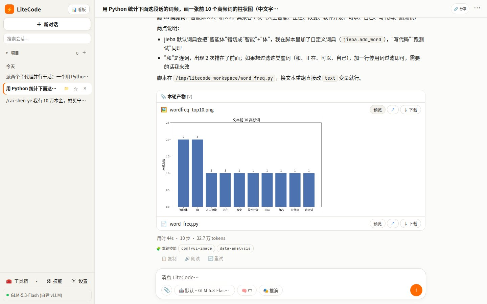

</div>

> The UI and most docs are Chinese-first; an English UI is available under Settings → Language.

---

## Contents

- [What it is, who it's for](#what-it-is-who-its-for)
- [Quick start](#quick-start)
- [Features](#features)
- [Screenshots](#screenshots)
- [Compared with OpenClaw / DeepSeek-TUI / WorkBuddy](#compared-with-openclaw--deepseek-tui--workbuddy)
- [Strengths and weaknesses](#strengths-and-weaknesses)
- [Build and release it yourself](#build-and-release-it-yourself)
- [Layout and architecture](#layout-and-architecture)
- [FAQ](#faq)
- [Version history](#version-history)

---

## What it is, who it's for

LiteCode is a **self-hosted AI agent platform**. It doesn't just chat: it breaks a job into steps, calls tools, runs commands, reads and writes files, checks the result, and hands you something you can open — a file, a chart, a video, a report.

| Good fit | Not a great fit |
|---|---|
| You want an assistant **you control**: data on your machine, your choice of model | Quick questions on your phone (a vendor app is easier) |
| You run a model (vLLM / Ollama) or buy an API and want it to do real work | Multi-tenant organisations with role management (LiteCode is single-user / small-team) |
| You need it to **drive a real Windows PC**, manage servers, run scheduled jobs | You have no LLM endpoint at all |
| Content work: documents, slides, voice-over, short videos, image and video generation | |

---

## Quick start

### A. Windows desktop edition: one-click install

No Docker, no command line.

1. **Requirements**: Windows 10 2004+ or Windows 11, 64-bit; virtualization enabled in BIOS (on by default on most PCs); about 10 GB free disk.
2. **Download** `LiteCode-Setup-<version>.exe` from [Releases](https://github.com/wfcz10086/litecode/releases) (an offline package of about 1.9 GB; nothing is downloaded during install). If Releases has no installer yet, build one with a single command — see [Build and release it yourself](#build-and-release-it-yourself).
3. **Double-click** → Next → enter your model URL, model name and API key (local models can leave it empty) → done.
   - If WSL has never been enabled, the installer asks for admin rights once to enable it and may need one reboot; it continues automatically afterwards.
   - The last step asks for admin rights once to "connect this PC" (installs OpenSSH set to start on boot, plus a desktop agent) so LiteCode can open programs, take screenshots and click on your PC. Click "No" to skip; you can do it later from the tray menu.
4. **Use it**: an icon on the desktop and Start menu, a tray icon, starts on boot. The window is `http://127.0.0.1:18790` and **only listens on this PC**. Default password `admin` — change it under Settings → Change password.
5. **Updates**: the tray checks daily and asks before updating. Code updates are about 9 MB and take a minute; chats and settings are kept; if the new version fails to start it rolls back. The local voice and knowledge-base models (about 900 MB) download in the background, resumable.

<details>
<summary>Silent / batch install flags</summary>

```
LiteCode-Setup-<version>.exe /S                    silent unpack
LiteCode.exe --setup --unattended --password <pw> --model-url <url> --model-name <model> --model-key <key> --no-tray
LiteCode.exe --selftest                            write WSL / distro / version / service status to selftest.txt
LiteCode.exe --local-control                       only connect this PC
LiteCode.exe --setup --no-local-control            install without connecting this PC
```

Exit code `3010` means a reboot is needed (it resumes after reboot); `2` means failure (see `%LOCALAPPDATA%\LiteCode\launcher.log`). Internals and troubleshooting: [docs/DESKTOP_WINDOWS.md](docs/DESKTOP_WINDOWS.md).

</details>

### B. Linux server: Docker

You need a Linux machine and Docker with docker compose.

```bash
git clone https://github.com/wfcz10086/litecode && cd litecode
./start.sh            # first run: creates config.json and builds the image (10–15 min); later starts take seconds
```

The first run creates `config.json` from `config.example.json` and asks you to edit it. Then:

```bash
./start.sh --restart  # apply the config
```

Open `http://<your-ip>:18790`. Other `start.sh` options: `--build`, `--down`, `--logs`, `--status`, `--shell`.

| Optional | How | Notes |
|---|---|---|
| SearXNG search | starts with compose | open-source metasearch on `127.0.0.1:18888`; a random secret is generated on first start |
| Knowledge base | `bash scripts/kb_setup.sh` | PostgreSQL + pgvector on localhost with random passwords, writes `config.json`; export the embedding model with `scripts/kb_export_onnx.sh`. See [docs/KNOWLEDGE_BASE.md](docs/KNOWLEDGE_BASE.md) |
| CLI | `sudo ln -sf $(pwd)/litecodeext/litecli /usr/local/bin/litecli` | then `litecli login`, `litecli` |

### C. Connect your model

In `config.json`, under `model`, set:

- `backend_url`: an OpenAI-style endpoint such as `http://host:8000/v1` — vLLM, Ollama, SGLang or any API relay.
- `api_key`: the key, or `EMPTY` for a local model without one.

Or just say in chat "add a model at … named …" and it adds it, tests it and makes it the default. Every model in Settings has a **Test** button; the model button next to the input box switches the model for **this conversation only**.

> Models with reliable tool calling work best. GLM-5.3-Flash, Qwen3.6/3.8 and DeepSeek-V4 complete long tasks reliably in our tests. If the main model can't see images, screenshot checks and OCR go to the vision model you configure.

### D. Login and ports

| Entry | Address | Auth |
|---|---|---|
| Web | `:18790` | one password: `web_ui.auth.password` in `config.json` (replace `CHANGE_ME_PASSWORD`) |
| API gateway | `:18789` | `Authorization: Bearer <server.token>` (replace `CHANGE_ME_TOKEN`) |
| CLI | `litecli login` | same password as the web |
| Remote desktop (noVNC) | `/vnc/` after web login | no separate port |

> ⚠️ Replace both `CHANGE_ME` values before exposing the server. The desktop edition only listens on 127.0.0.1.

### E. CLI and API

- **CLI**: `litecli` — shows diffs, runs commands, reports token usage; `litecli passwd` changes the password.
- **API**: the gateway is a standard OpenAI Chat Completions endpoint. Point any client (ChatBox, Dify, LangChain, translation plugins…) at `http://<host>:18789/v1` and the model behind it gains tools, search, memory and every skill. Send a fixed `user` value and it remembers that user.
- Add `disabled_tools: ["web"]` to a request to disable a tool group for that request (offline mode, fair benchmarks).

---

## Features

Every item below maps to code in this repository; tool or skill names are in parentheses.

### 1. Agent core

| Feature | Details |
|---|---|
| Autonomous execution | plan (`task_create/update/done`) → call tools → check → verify → deliver; deliveries carry evidence and say "verified / not verified" |
| Steer mid-task | send messages while it works: Enter = add a note, **⚡ Now** = redirect within a second without ending the turn |
| Stop means stop | takes effect within a second; the conversation's background processes stop too |
| Keeps running when you close the page | turns run in the background; come back and it reconnects |
| Thinking level | switch thinking strength next to the input; if thinking loops it is cut and the next step acts directly |
| Strategist mode | **🎭** asks "who released this, who benefits, who's on the other side" before concluding |
| Loop guards | repeated identical calls are blocked; read-only streaks get a nudge; timeouts return the last output |
| Call timeline | every step with a readable name, status and duration, expandable; errors are classified cards with "continue from the failed step" |
| Sub-agents | `spawn_agent` with 9 roles (coder, researcher, tester, writer, reviewer, vision, operator…); coding helpers work in separate worktrees in parallel and merge after review |
| Sub-agent tree | see each helper's steps and result, open it live, send instructions, stop it |

### 2. Skills (110)

| Feature | Details |
|---|---|
| `/` picker | type `/` in the input to search and pick skills (multi-select) |
| Skill manager | browse by group, enable/disable, view, export; safety scan before install |
| Skill market | search and install from Anthropic Skills, ClawHub (OpenClaw ecosystem), SkillHub and GitHub |
| Create from chat | "turn what we just did into a skill" → `create_skill` drafts it |
| Groups | office docs, image/audio/video, novel writing (26 genres), programming, research, ops, planning, desktop/browser, investing, personas |

### 3. Search and research

| Feature | Details |
|---|---|
| Layered search | SearXNG (primary) → optional Volcano Doubao search → parallel engines → real browser; Chinese queries use the zh-CN region |
| Reads the page | `web_fetch` and `deep_search` open results and read the text before answering, with citation checks |
| Developer search | `github_search`, `github_repo`, `package_search`, `stackoverflow_search`, `search_code_error` |
| Live quotes | `stock_quote`: A-share, HK and US stocks, indices and ETFs |
| Browser | `browser_*`: open, click, fill forms, keep logins, hand captchas to you, watch live over noVNC |

### 4. Documents and office

| Feature | Details |
|---|---|
| Word / Excel / PPT / PDF | `docx` `xlsx` `pptx` `pdf` skills: create, read, edit; Excel formulas recalculated and checked |
| Document studio | `doc-studio`: HTML-first layout with openly licensed photos, charts and illustrations; export PDF / editable PPTX / DOCX / long image; screenshot QA at the end |
| Deep reports | `deep-report`: 5,000–20,000 characters, search while writing, citation density checks, review loop |
| Scans and OCR | `pdf-ocr-pipeline`, `image-ocr`, `vision_ocr` |
| Artifacts | file paths in replies become login-protected preview/download cards; an Artifacts page collects them |
| Sharing | read-only links (1/7/30 days, revocable) |

### 5. Image, audio, video

| Feature | Details |
|---|---|
| ComfyUI images | `comfyui-image`: give it `host:port` and it probes GPUs, models and workflows; ships Qwen-Image 2.1 text-to-image / edit / multi-image templates; internal hosts via SSH jump host, reused for the same subnet |
| ComfyUI video | `comfyui-video`: ships MiniMax H3 in four modes (text-to-video, image-to-video, first/last frame, reference-to-video, with audio) and can use other saved workflows |
| Local TTS (CPU only) | `text_to_speech`: sherpa-onnx + Kokoro, no GPU, no network; edge-tts and cloud TTS as fallbacks |
| Voice-over video | `video-studio`: script → voice → subtitles aligned to real speech → visuals → music ducked under speech → final video, checked for A/V sync |
| Music | `bgm-music`: royalty-free BGM generated locally (8 moods) or CC-licensed tracks with attribution |
| Douyin toolkit | `douyin-toolkit`: parse share links, download without watermark, transcribe + read key frames, local watermark removal |
| One-line short videos | `douyin-explainer-video`: topic → script → voice → animation → music → vertical video + cover + post text, with fact, layout and frame checks |
| Vision | `vision_ocr` falls back to a vision model when the main model can't see images |

### 6. Knowledge base and memory

| Feature | Details |
|---|---|
| Knowledge base | upload in the 📚 panel; PostgreSQL + pgvector, files stored locally, local Chinese embedding model; `kb_search` returns sources |
| Four-layer memory | L0 recent turns → L1 resident profile → L2 categorised notes → L3 full-text index; preferences and identity follow you across chats |
| Learns from corrections | say "use a domestic mirror" once and it remembers next time |
| Inspectable | view and delete memories; external content can't write global memory |
| Crash-safe | write-ahead log replay; snapshots before big changes, with rollback |

### 7. Pipelines and schedules

| Feature | Details |
|---|---|
| DAG pipelines | visual editor: 9 agent node types, tool nodes, decision branches, sub-pipelines; `when` conditions, passing values between steps; parallel layers, retry with reflection, content-hash checkpoints, resume |
| AI-generated pipelines | describe it in a sentence, then tweak |
| Build history | Jenkins-style builds with per-step output and artifacts |
| Scheduled jobs | "every day at 9, check BTC and send it to WeCom" → `create_timer`; history kept; runs on the server, **even when your PC is off** |

### 8. Controlling PCs and servers

| Feature | Details |
|---|---|
| Windows GUI | `windows_desktop`: screenshots, OCR, click by control name (UI Automation), type, scroll, right-click, drag, clipboard, launch apps, open URLs, manage windows |
| Windows command line | `windows_system`: PowerShell, processes, services, system info, install software, files, transfers between PC and server (chunked, sha256-checked); shell access is off by default and only you can turn it on per PC |
| Desktop edition controls this PC | command line first, screenshots only to verify; files go straight to your Desktop / Documents / Downloads |
| Remote PCs | "Add Windows" generates one command to paste in an admin terminal; the PC connects out, no open ports; auto-updates when idle, restarts after crashes |
| Lock / disconnect diagnosis | when screenshots fail it reports the real session state (disconnected / locked / RDP minimised) and how to fix it |
| SSH ops | `ssh_exec`, `ssh_read_file`, `ssh_write_file`, `ssh_sync_files`, host book; remote Docker inspect and recreate |
| Local Docker | list containers, read logs, restart from chat |
| Linux desktop | a Linux desktop inside the container (watch via noVNC), driven with `desktop_*` |

### 9. Channels

| Feature | Details |
|---|---|
| Web | 7 themes, Chinese / English UI, works on phones; grouped chats, projects, search |
| CLI | `litecli`: diffs, commands, token stats |
| WeChat | personal WeChat bot via QR login; handles files, voice and images |
| WeCom | WeCom smart bot with true streaming replies |
| OpenAI-compatible API | for any client |

### 10. Usage, security, operations

| Feature | Details |
|---|---|
| Usage dashboard | **📊**: total tokens, cache hits, thinking, calls, hourly usage, active hours, per skill and tool; export CSV and an offline HTML report |
| Prompt-injection defense | web pages, search results, screenshot text and remote output are marked as external data; after injection patterns, sending messages, paying, exfiltrating, writing memory or creating schedules need your approval |
| Public upload gate | files can't go to public file hosts or image hosts unless you asked to share publicly |
| Secret masking | keys masked in config and model lists; memory writes are scrubbed |
| Full trace | every iteration, tool call and pipeline step is logged; silent failures are surfaced |
| Large files | 1 GB streamed uploads, resumable downloads, chunked reads of any size |
| Screen recording | **⏺** records each turn to mp4 with step captions |

---

## Screenshots

**Transparent execution** — every step, how long it took, expandable; artifacts preview inline.

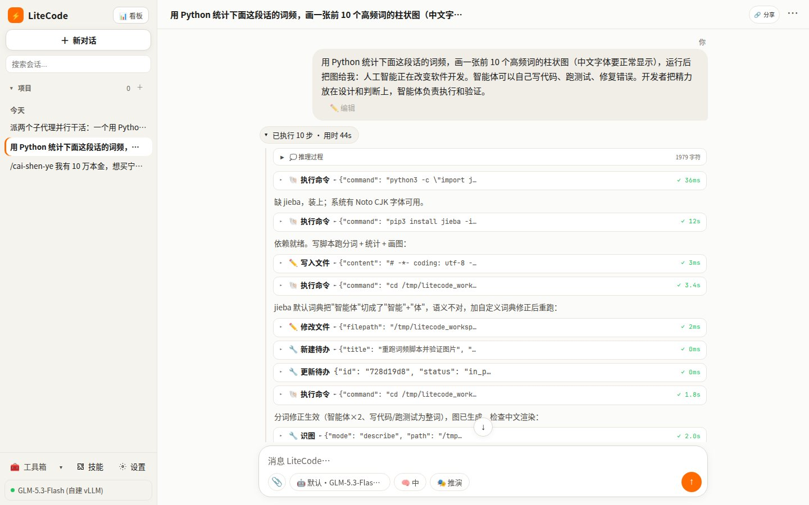

**Sub-agent tree** — two helpers write the Python and Go versions in parallel, both pass their tests, the main agent re-checks and summarises.

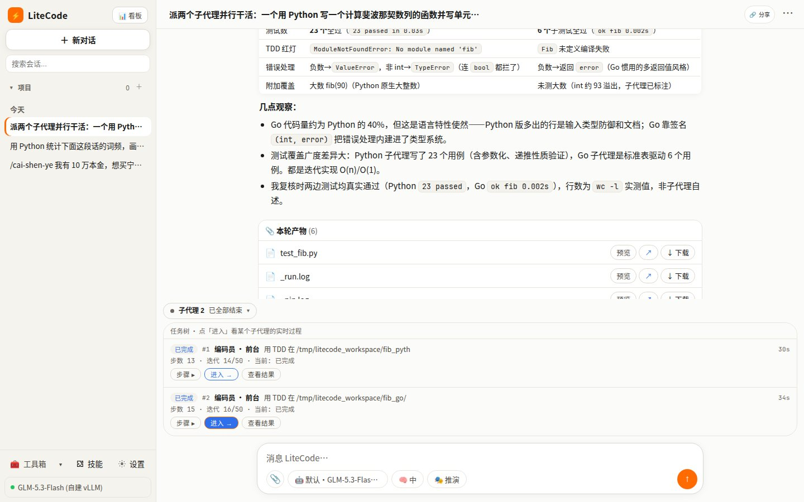

<table>
<tr>
<td align="center" width="50%"><b>Type / to pick skills</b><br>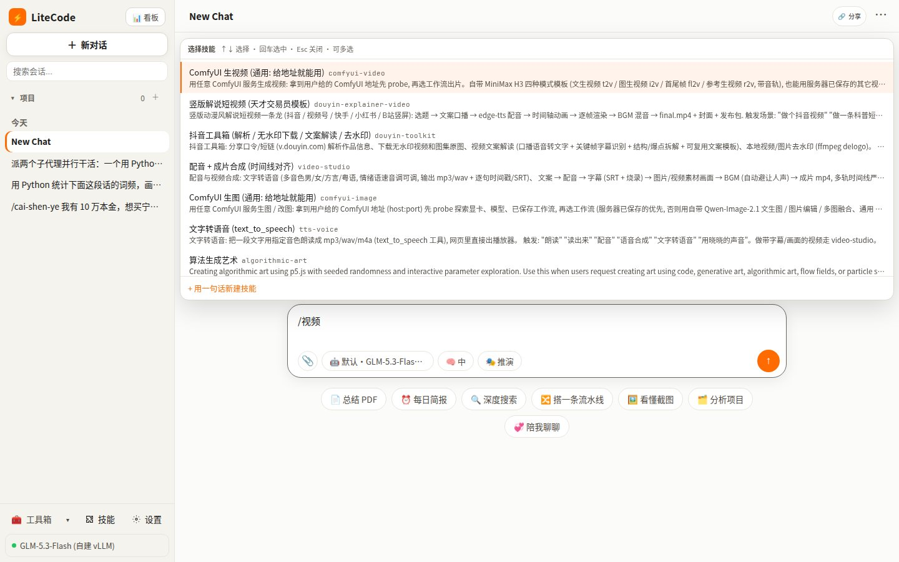</td>
<td align="center" width="50%"><b>Skill manager + market</b><br>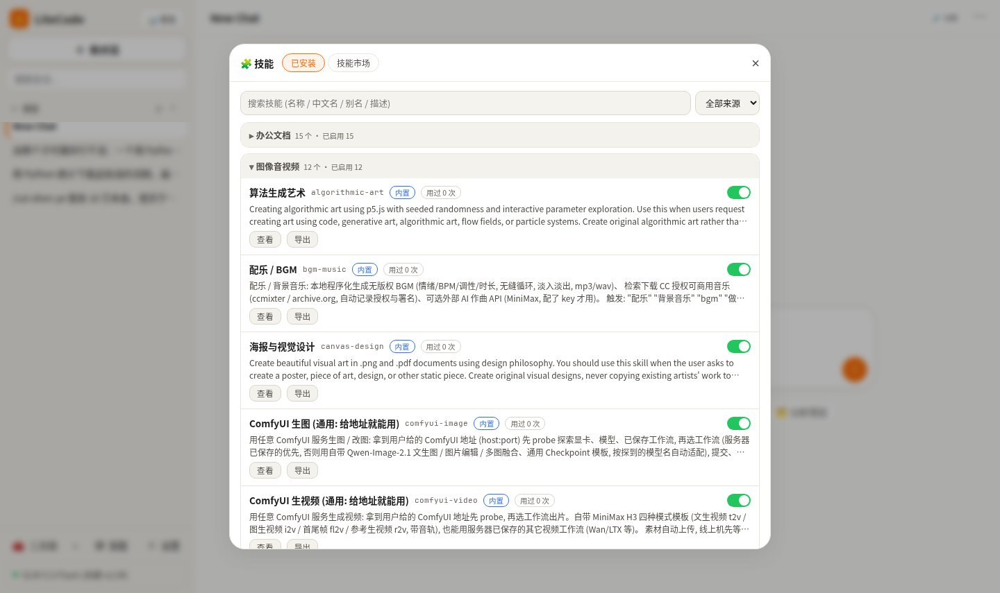</td>
</tr>
<tr>
<td align="center"><b>Usage dashboard (HTML report export)</b><br>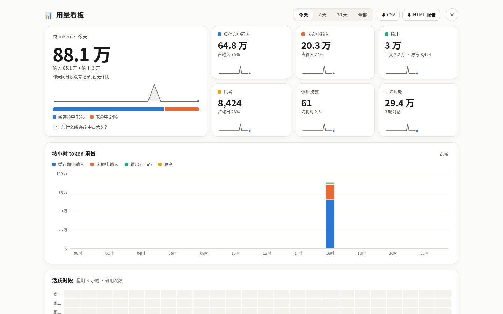</td>
<td align="center"><b>Settings: models, themes, language</b><br>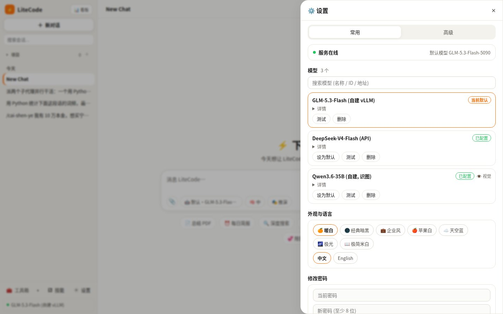</td>
</tr>
<tr>
<td align="center"><b>Toolbox: memory, KB, schedules, DAG, WeChat, Windows…</b><br>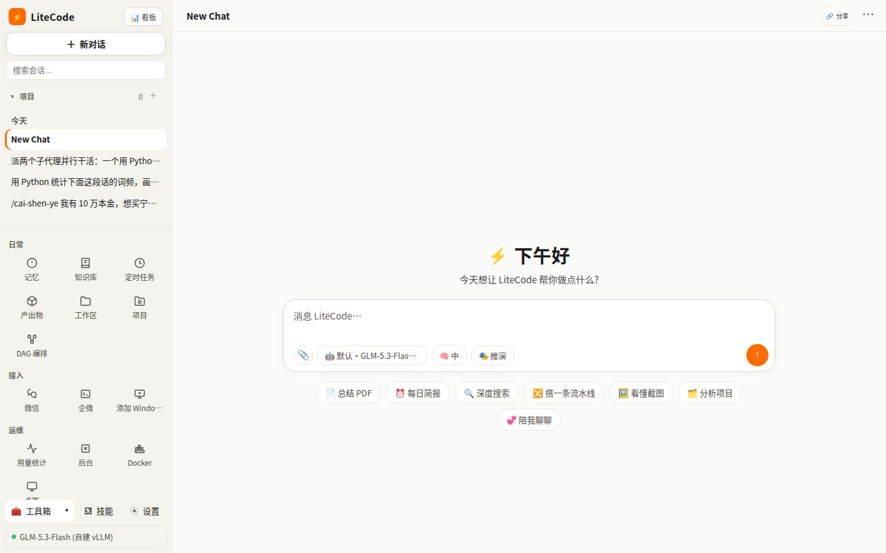</td>
<td align="center"><b>DAG pipeline editor</b><br>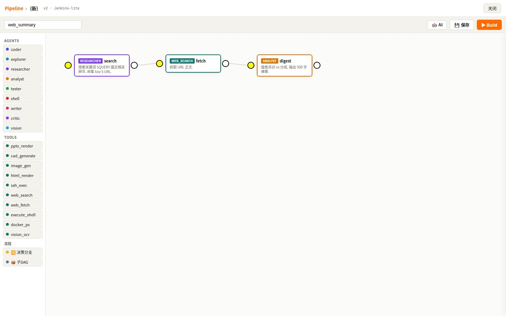</td>
</tr>
<tr>
<td align="center"><b>Position sizing with live quotes</b><br>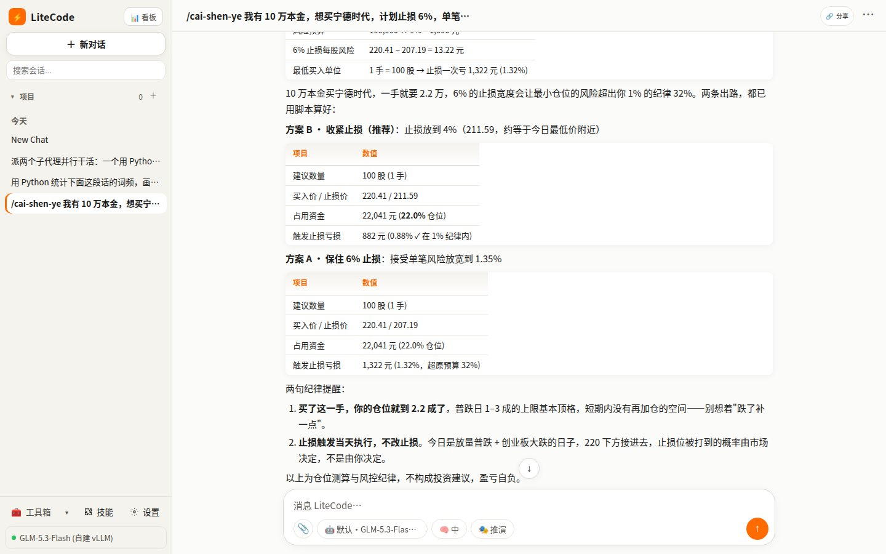</td>
<td align="center"><b>CLI</b><br>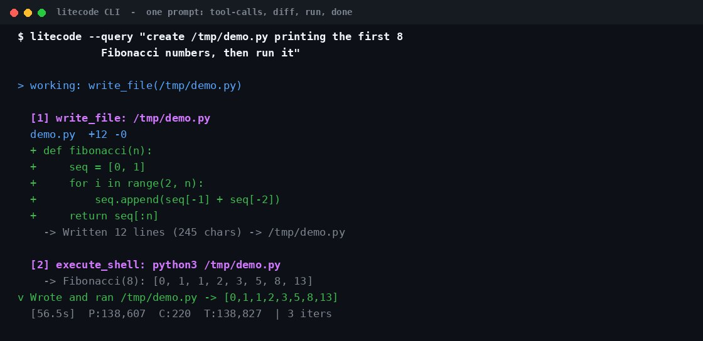</td>
</tr>
<tr>
<td align="center"><b>Windows desktop edition: one-click update</b><br>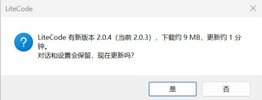</td>
<td align="center"><b>WeChat bot</b><br>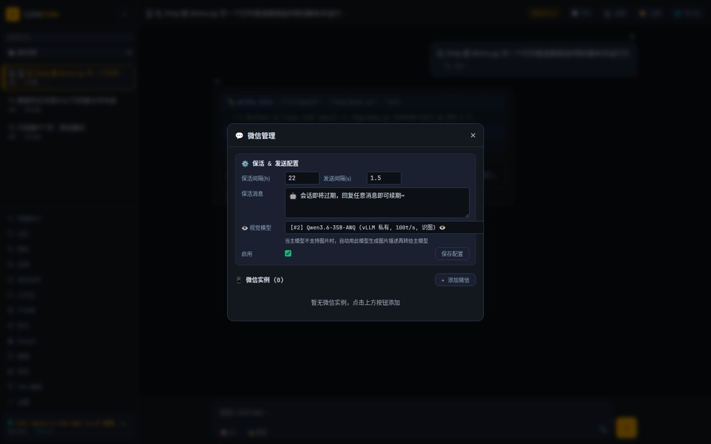</td>
</tr>
</table>

**A Douyin remake from one request**: find a video → download without watermark → extract the script → Qwen-Image 2.1 reference image → MiniMax H3 image-to-video → local voice-over + subtitles + music → final cut (frames below; all visuals AI-generated, script rewritten).

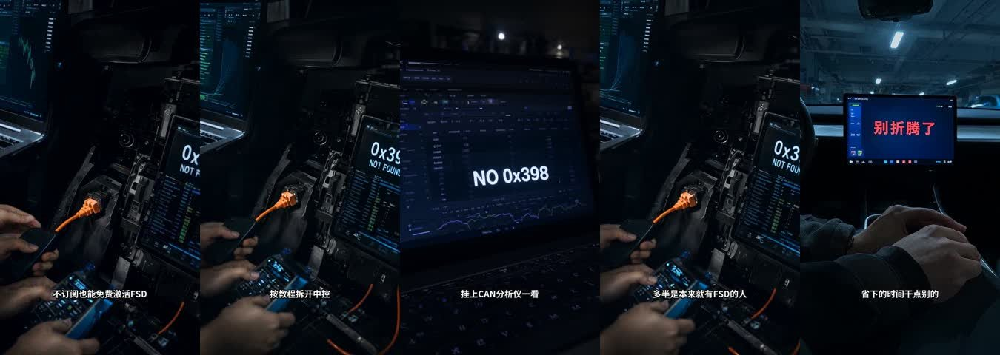

---

## Compared with OpenClaw / DeepSeek-TUI / WorkBuddy

> Compiled in October 2026 from each project's official repository and public material; details change between versions. The LiteCode column reflects this repository. Different products aim at different things — this is not a score card.

| | **LiteCode** | **OpenClaw** | **DeepSeek-TUI** (now Codewhale) | **Tencent WorkBuddy** |
|---|---|---|---|---|
| Form | self-hosted platform: web + CLI + bots + API | self-hosted personal assistant used from chat apps | terminal coding agent (plus a web UI) | commercial desktop app + cloud |
| License / price | MIT, free | MIT, free | MIT, free | closed source, credit subscription |
| Models | any OpenAI-compatible incl. self-hosted vLLM/Ollama, per-chat switching | cloud models + Ollama | 40+ providers, DeepSeek by default | Hunyuan/DeepSeek/GLM/Kimi/MiniMax; free tier can't choose |
| Windows install | **offline installer**, tray, autostart, auto-update | WSL2 + Node | single binary | installer |
| Chinese chat apps | **WeChat and WeCom built in** | mostly global channels (WhatsApp/Telegram/Slack…) | none | WeCom/QQ/Feishu/DingTalk |
| Web UI | **full**: chats, artifact previews, dashboard, settings, admin panels | chat-channel first | yes (`codewhale web`) | yes |
| Windows desktop control | **yes**: control clicks + OCR + PowerShell, lock/disconnect diagnosis | host actions | macOS only, experimental | macOS only, experimental |
| Server ops (SSH/Docker) | **yes** | via shell | via shell | no |
| Visual pipelines | **DAG editor** with conditions, branches, sub-pipelines, resume | no | no | no |
| Scheduled jobs | yes, on the server, run while your PC is off | yes (Heartbeat) | no | yes, stop when the PC is off |
| Sub-agents | 9 roles, parallel worktrees, visual task tree | not a focus | yes, parallel sub-tasks | expert teams |
| Skill ecosystem | 110 built in + market (installs ClawHub/Anthropic/SkillHub/GitHub skills) | **ClawHub, the largest** | MCP | SkillHub, large |
| Knowledge base | built in (pgvector) | local Markdown memory | no | yes |
| Local CPU TTS | **yes** | voice via companion apps | no | not seen |
| Image / video generation | ComfyUI at any address + plugins | via skills | no | yes (cloud) |
| Douyin parse / de-watermark / remake | **native** | via skills | no | third-party skills |
| Usage & cost dashboard | **yes**, exportable | not seen | not seen | credit deductions |
| Mobile app | no (web works on phones) | **iOS / Android** | no | **yes** |
| macOS | via Docker | **native** | **native** | **native** |
| Community | small | **largest** (390k+ GitHub stars) | large (40k+ stars) | huge user base |
| Sandbox | injection defense + approvals + snapshots + shell switch | configurable sandbox | **OS-level sandbox** (Seatbelt / bubblewrap) | sandbox + permission cards |

### Where LiteCode is ahead

1. **vs OpenClaw**: works out of the box in China — WeChat and WeCom built in, SearXNG plus domestic engines, domestic mirrors for downloads; a full web workspace (artifact previews, usage dashboard, DAG pipelines, knowledge base) rather than chat-only; an offline Windows installer instead of setting up WSL and Node yourself; Windows desktop control and server ops. It can also install ClawHub skills.
2. **vs DeepSeek-TUI**: that is a coding terminal; LiteCode is an all-round assistant — besides code it does documents, slides, voice, video, knowledge base, schedules, bots and PC control, with visual pipelines and a sub-agent tree, and isn't tied to one model vendor.
3. **vs WorkBuddy**: open source and free with no credits; your data and models stay with you, including self-hosted models at zero marginal cost; schedules run on the server even when your PC is off; Windows desktop control works (their computer-use is macOS-only and experimental); SSH ops and visual pipelines; Douyin parsing, voice-over and video assembly are native.

### Where LiteCode is behind

1. **Ecosystem and community**: OpenClaw and WorkBuddy are far larger.
2. **Reach**: no mobile app; no QQ, Feishu, DingTalk, Telegram or WhatsApp.
3. **Platforms**: no native macOS app (Docker only); the Windows installer is large (~1.9 GB + a 900 MB model pack).
4. **Sandbox**: no OS-level sandbox like DeepSeek-TUI; safety relies on approvals and permission switches.
5. **Teams**: single-user / small-team; no members or org roles.

---

## Strengths and weaknesses

**Strengths**

- **One brain, four doors**: web, CLI, WeChat / WeCom and the API share memory and skills.
- **Actually does the work**: plans, runs, verifies, delivers with evidence; you can steer mid-task.
- **Broad**: coding, office docs, research, knowledge base, voice and video, image and video generation, schedules, pipelines, PC control, server ops.
- **Private**: self-hosted, any model, data stays home; the desktop edition listens on localhost only.
- **Extensible**: a tool is one plugin file, a skill is one `SKILL.md`, external projects mount in and unplug with one env var.
- **Observable**: call timeline, sub-agent tree, usage dashboard, full traces.
- **Engineered**: 1,800+ automated tests that must pass before release; a privacy self-check on the public package; desktop updates roll back on failure.

**Weaknesses**

- Quality depends on the model's tool calling; small models tend to loop.
- Docs and UI are Chinese-first.
- The Windows desktop edition is new; edge cases (multiple monitors, RDP reconnects) are still being polished.
- No voice input on the web; no mobile app.
- Designed for one user, not an organisation.

---

## Build and release it yourself

### Server image

```bash
./start.sh --build                     # builds litecode:v12-r1 from the Dockerfile and starts it
```

The `Dockerfile` installs system libraries, Python dependencies, Playwright browsers, noVNC and sherpa-onnx. Code directories are bind-mounted in `docker-compose.yml`, so code changes only need `./start.sh --restart`.

### Windows installer

On a Linux build machine with Docker, Go 1.26+ and `makensis` (8 GB free disk):

```bash
./start.sh --build                                         # base image litecode:v12-r1
LITECODE_DIST_DIR=$PWD/dist/win \
LITECODE_UPDATE_URL=https://your-download-dir/ \
LITECODE_NO_PUSH=1 \
bash packaging/release.sh 2.0.6 --full                     # offline installer + code update + latest.json
```

- Output in `LITECODE_DIST_DIR`: `LiteCode-Setup-<version>.exe`, `litecode-code-<version>.tar.gz`, `latest.json` (and `litecode-models-*.tar` when model sources are present).
- `LITECODE_UPDATE_URL` is where the tray checks for updates and downloads models; put those files in that directory on any static file server.
- Drop `--full` when only code changed: a ~9 MB code update in 1–2 minutes, offered to desktop users by the tray.
- The script runs the full test suite first (`scripts/run_release_tests.sh`) and stops on any failure; `lib/version.py` must match the release number.

### Tests

```bash
cd litecodeext && python3 -m pytest -q tests/
bash tests/smoke.sh
cd packaging/windows && go test ./... && go vet ./...
```

---

## Layout and architecture

```
   WeChat / WeCom bots ┐
   CLI litecli         ├──▶  gateway :18789 (OpenAI compatible; agent loop, tools, memory)
   Browser ────────────┘            ▲
                                    │
                     Web UI :18790 (chats, artifacts, dashboard, DAG, schedules, KB, skills, settings)
                                    │
         ┌────────────┬─────────────┼──────────────┬───────────────┐
      SearXNG      KB Postgres   Windows nodes     SSH hosts      ComfyUI / model servers
```

| Path | Contents |
|---|---|
| `litecodeext/litecode_server.py` | gateway and agent loop entry |
| `litecodeext/web_ui.py` + `routers/` | web server and API routes |
| `litecodeext/web_assets/` | front end (plain JS, no build step) |
| `litecodeext/lib/` | agent loop, memory, tool groups, Windows nodes, security |
| `litecodeext/core/` | tool dispatch, search, TTS, memory storage |
| `litecodeext/plugins/` | plugins: tools, knowledge base, image generation — one file per tool |
| `litecodeext/skills/` | 110 skills (`SKILL.md` + scripts) |
| `packaging/` | Windows desktop edition (Go tray + NSIS installer + WSL rootfs) and release scripts |
| `docs/` | architecture, desktop edition, knowledge base, versioning |

More in [docs/ARCHITECTURE.md](docs/ARCHITECTURE.md).

---

## FAQ

**No GPU?** Fine. Use any API for the model; local TTS and the KB embedding model run on CPU.

**Does data leave my machine?** Not on its own. Chats, memory and files stay local; only your model endpoint and the sites you ask it to search or open receive requests. It can't upload files to public hosts unless you ask.

**Does the desktop edition run schedules when the PC is off?** No — it starts on boot, but it stops with the PC. Use the server edition for always-on jobs.

**Can it work while the screen is locked?** Command-line work (files, processes, installs) continues; GUI actions report why they can't proceed and how to fix it (e.g. `tscon` an RDP session back to the console).

**Claude / GPT?** Yes, through any OpenAI-compatible endpoint or gateway.

**Upgrading?** Server: `git pull && ./start.sh --restart` (`--build` if dependencies changed). Desktop: tray → Check for updates.

---

## Version history

### v2.0.10 "Desktop" (上桌) (2026-10-22)

> Desktop polish: offline voice-over and knowledge base, faster search, and clear reasons when remote control hits a locked or disconnected screen.

**v2.0.10**
- 🌐 **Web fetch works behind a local proxy**: fake-IP addresses (198.18.x) and IPv6-mapped public addresses are no longer blocked as internal; real private ranges still are.

**v2.0.9**
- 🔄 **Sidebar auto-refresh**: chats created or updated from WeChat, WeCom or background jobs appear without reloading; the open chat updates when new messages arrive.
- 💬 **Adding a WeChat bot turns WeChat on**, so bots come back after a restart.
- 🪟 **Steadier PC control**: bundled OpenSSH first (Windows Update only as a time-limited fallback); Python and agent dependencies ship with the installer; inherited Python env vars are cleared; domestic mirrors by default in the distro.

**v2.0.8**
- 🪟 **Fixed Windows install failing with a localhost proxy on** ("invalid character 'w'"): WSL's proxy notice no longer leaks into the config and version the installer reads; when a localhost proxy is detected the installer switches WSL to mirrored networking so the distro can use it too (an existing `networkingMode` is left alone).

**v2.0.7**
- 💬 **WeChat bridge SDK 0.3.0**: when login asks for a pairing code, an input box appears in the WeChat panel; already-bound bots reuse their login; online/offline is reported to the server.
- 🔄 **Desktop updates straight from GitHub**: releasing means pushing a tag; the tray reads `latest.json` in the repo and installs that tag's source archive.

**v2.0.6**
- ⚙️ **Settings**: model-reference fields, search mode and log level are dropdowns; the current model's id/URL follow the model list; DAG tool steps offer tool and sub-DAG names in a dropdown.
- 📦 **Open-source build works out of the box**: the public repo ships noVNC and the SearXNG config; `./start.sh` creates the config on first run; the Windows installer's update URL is set with `LITECODE_UPDATE_URL`.

**v2.0.5**
- 🪟 **Full installer refresh**: tray fixes (model-pack import, working directory) are in the installer; the displayed version matches the release and is enforced at release time.

**v2.0.4**
- 🔍 **5× faster desktop search**: without SearXNG, Chinese queries go to bing / sogou first and failing engines cool down — ~45 s down to ~8 s.
- 🖥️ **Lock / disconnect diagnosis** when screenshots fail, with `tscon` for locked RDP sessions.
- 🖱️ **Coordinate system inferred** when a click doesn't say whether it uses screenshot or screen pixels.
- 🗣️ **Video voice-overs use the local CPU engine first**, online voices as fallback.
- 🧠 No reasoning leaking into replies on no-think turns; follow-up requests no longer get nagged to re-plan.
- 🎨 **ComfyUI reuses a remembered SSH jump host for the same subnet.**

**v2.0.3**
- 🧩 **Skill management**: `/` picker, skill manager (groups, toggles, safety scan, install), market (Anthropic / ClawHub / SkillHub / GitHub), create skills from chat.
- 📊 **Usage dashboard**: token ledger by hour / skill / tool, CSV and offline HTML export.
- 🔗 **Call timeline + friendly errors** with "continue from the failed step".
- 🔍 **Search**: pinned SearXNG, optional Doubao search, weak engines disabled; `stock_quote` live quotes.
- 🗣️ **Local CPU TTS** (sherpa-onnx + Kokoro) with pluggable engines; add, test and switch models from chat (`manage_models`).
- 🎨 **ComfyUI image / video skills**: give `host:port`; Qwen-Image 2.1 and all four MiniMax H3 modes verified.
- 📚 **Knowledge base**: PostgreSQL + pgvector + local Chinese embeddings, sources cited.
- 📄 **Document studio**: HTML-first with real photos and charts, exported to PDF / editable PPTX / DOCX / long image with QA.
- 🤖 **Sub-agent tree**: observable, enterable, steerable; worktree branches reviewed before merge.
- 💰 **Position-sizing persona** for A/HK/US stocks and Binance USDⓈ-M futures (leverage, liquidation estimate).
- 🖥️ **Desktop edition controls this PC**: OpenSSH installed and started on boot, local node `this-pc`; "this computer" always means Windows; programs it opens for you run unelevated.
- 🛡️ **Public upload gate**: no uploads to public file hosts unless you asked to share publicly.
- 📦 **Separate model pack** keeps the installer under 2 GB; voice and KB models download in the background.

<details>
<summary>v2.0.0 – v2.0.2 "Desktop" (2026-10-21)</summary>

> On your desktop: double-click to install on Windows, and steer it mid-task without starting over.

- 🗣️ **Steer while it works**: Enter = add on, **⚡ Now** = redirect; notes appear in the step timeline.
- ⏹️ **Stop actually stops** within a second, including background processes.
- 🧠 **Correct it once, it remembers.**
- 🔍 **Search before downloading**; domestic mirrors; big downloads in the background.
- 📎 **Previews for delivered files.**
- 🪟 **Windows desktop edition**: offline installer with WSL, tray, autostart; ~10 MB code updates with automatic rollback.
- 🎬 **Screen recording** of each turn with captions.
- 🔗 **Sharing & stats**: read-only links; token usage and duration per turn.
- 🤔 **No more endless thinking**: cut off and act.
- 👁️ **Vision fallback** to a model that can see images.
- 🎨 **Redesign**: warm-white theme, unified input, grouped chats, collapsed tool steps, settings drawer, mobile-friendly.
- 🧠 **Human-like memory**: global profile, overwrites, paraphrase recall, inspectable and deletable.
- 🖱️ **Steadier remote control**: control-name clicks, window following, settle waits, final checklist; queueing; 1 GB transfers with sha256.
- 📦 **Large files**: 1 GB streamed uploads, resumable downloads, chunked reads.
- 🎬 **Douyin and audio/video**: link parsing, no-watermark download, script analysis, multi-track voice-over videos, music.
- 🛡️ **More reliable**; 💰 **half the tokens** (fixed prompt ~49k → ~25k); 🪟 **sturdier desktop edition**.

</details>

<details>
<summary>v1.10.16.91 "Gatekeeper" (2026-10-19)</summary>

- 🔑 Change the login password (Settings or `litecli passwd`).
- 🤖 Per-conversation model switching (`/model name`, `/model default`), test button per model.
- 🛡️ Prompt-injection defense: external content is data only; sensitive actions need approval.
- 🚪 Nothing without logging in: noVNC behind the web login, gateway stats need a token, share links up to 30 days.
- 🧹 Hardening: HTML sanitising, key masking, sandboxed SVG/HTML previews, path traversal fixes.

</details>

<details>
<summary>v1.10.16.90 "Brisk" (2026-10-19)</summary>

- 👥 Background helpers with a web panel; parallel coding in separate worktrees with automatic merge; evidence required.
- ⏱️ No idle waiting, no spinning: explicit completion signals, real timeouts with last output.
- 🎬 Richer videos: 8 script styles, script checks, sentence-level narration, subtitles timed to real speech.
- 🪟 Safer Windows control: read-back checks, shell switch as a real permission boundary, signed components, auto rollback of agent updates.
- ⚡ Smoother long chats.

</details>

<details>
<summary>v1.10.16.89 "Errand Runner" (2026-10-16)</summary>

- 🪟 One-command Windows onboarding; the PC connects out, no open ports; one-click full uninstall.
- 🤖 General desktop operation: WeChat, QQ, Chrome, live rooms — click, type, scroll, copy, read the clipboard.
- 🔄 PC agents auto-update and self-heal.
- 🛡️ Safer messaging: asks when several contacts match; never clears your draft; checks the window title.

</details>

<details>
<summary>v1.10.16.88 / v2026.10.16 "Night Shift" (2026-10-16)</summary>

- 🎬 One-line Douyin videos with fact, layout and frame checks.
- 🔌 Turns keep running when you close the page.
- 🧯 Quieter, more accurate system nudges.
- 🛡️ `disabled_tools` per request.
- 📏 SWE-bench Verified harness, offline by default with network-use detection.

</details>

<details>
<summary>v1.3 – v1.10 (2026-05 – 2026-10)</summary>

| Version | Theme |
|---|---|
| v1.3 | consistency, timers, telemetry, autonomy |
| v1.4 | tools & intelligence: memory, MCP, RAG, plan-then-act, projects |
| v1.5 | DAG orchestration, permissions, hooks, web E2E, complex scenarios |
| v1.6 | browser, LSP, skill governance, desktop |
| v1.7 | autonomy, SWE-bench, marketing |
| v1.8 | backtesting, telemetry, audit, three-client alignment |
| v1.9 | stability, performance, web E2E, domestic builds |
| v1.10 | router split, plugin mounts, DAG editor, memory panel, Windows nodes, ChatGPT-level web UX |

</details>

<details>
<summary>v1.1 / v1.1.1 long-form writing (2026-04-18)</summary>

- 21 novel-genre skills, `long-novel` (million-character projects), `outline-generation`, `longtext-processing`.
- `deep-report` (5,000–20,000 characters with citation checks) and `anti-ai-tell-audit`.

</details>

<details>
<summary>v12.x early internal builds (2026-04)</summary>

- v12.9: sub-agent interrupt propagation and live streaming; direct data sources for crypto / stocks / weather; front end split into local static assets.
- v12.7: "sub-task" keywords route to sub-agents.
- v12.6: three-layer zombie-process defense, self-learning loop, skill safety, prompt rewrite, real loop detection.
- v12.5: reasoning compatibility across backends, WeChat latency fix, reasoning shown in the web UI.
- v12.2: fixes from a 73-task end-to-end run (tool dispatch, multi-agent orchestration, memory compression).
- v12.1: server split; automatic reasoning-parameter adaptation for vLLM / OpenAI / Anthropic / Ollama / DeepSeek.

</details>

---

<div align="center">

If it helps you, a ⭐ means a lot. Questions and ideas welcome in [issues](https://github.com/wfcz10086/litecode/issues).

</div>

## License

MIT
