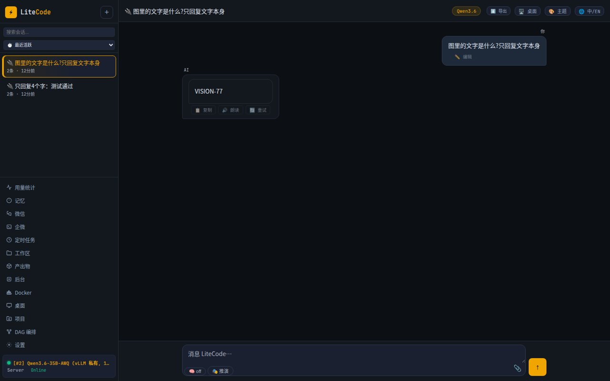
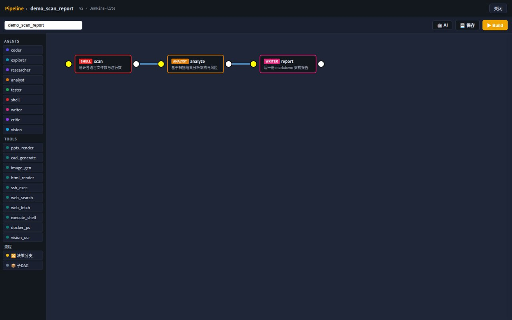
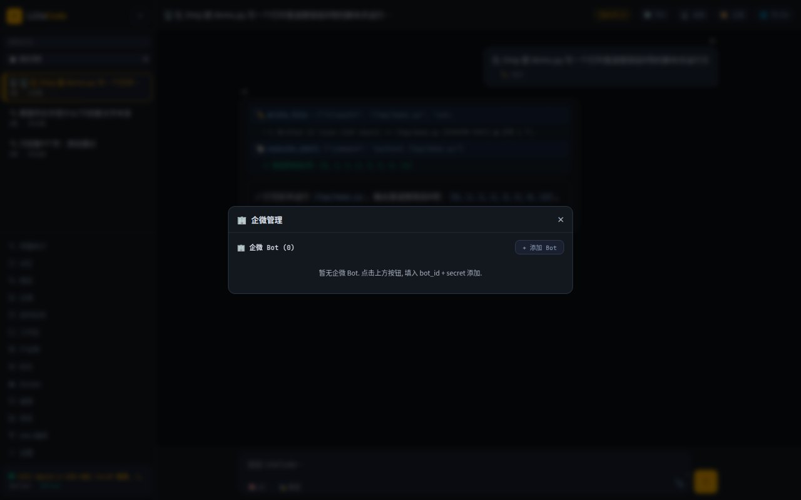
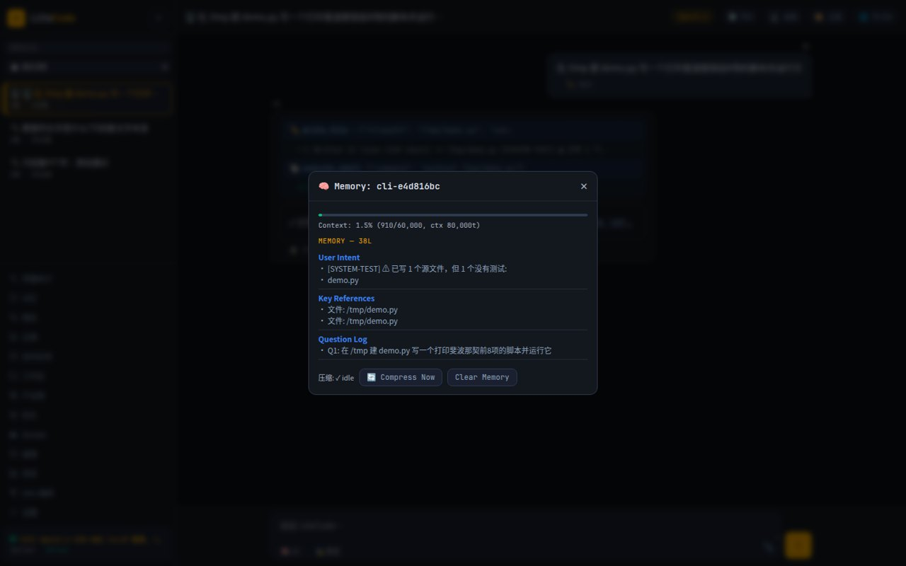
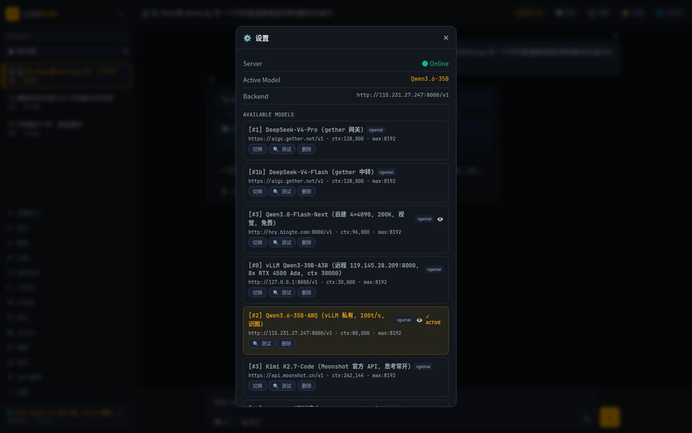
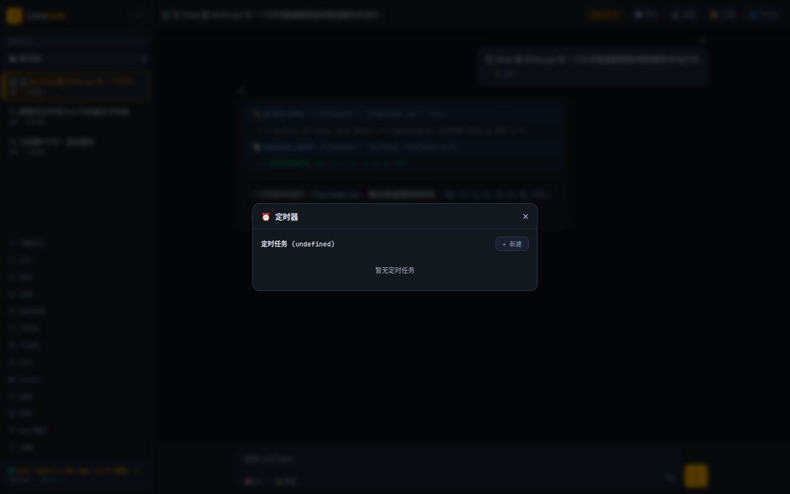
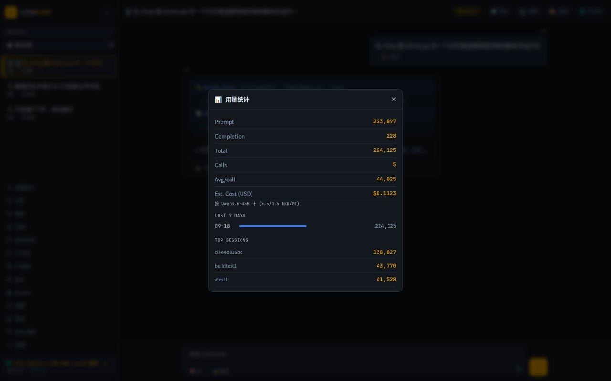
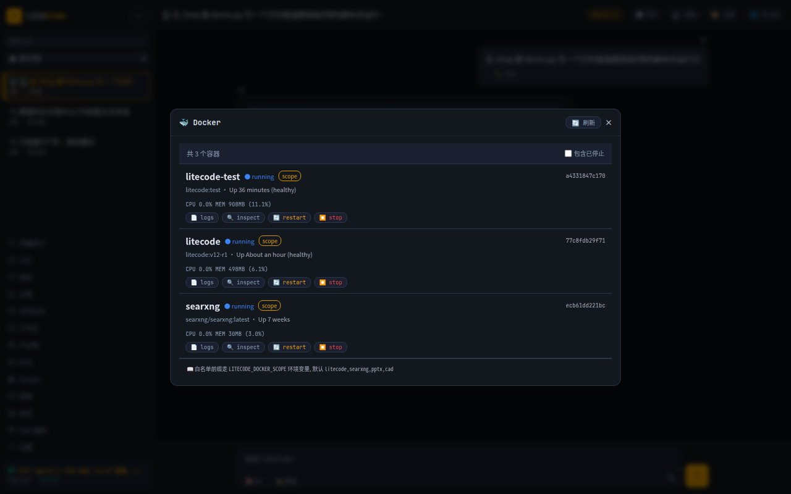
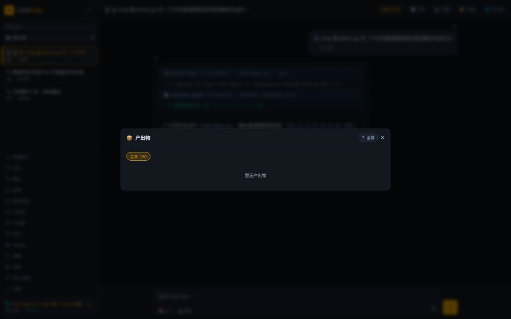
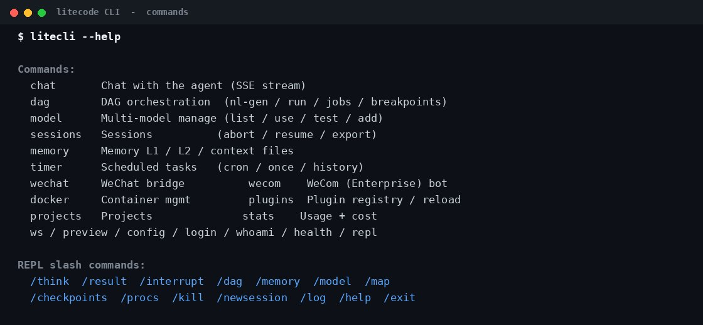

<div align="center">

# ⚔️ LiteCode

[中文](README.md) · **English**

**LiteCode isn't another chat window — it's the first AI employee that lives on your machine.** In the browser it's your strategist; in the terminal it's your engineer; on WeChat it's the assistant that always picks up. Same brain, real memory, real skills, works on its own schedule. Salary: zero. Data: yours. Cloud vendors don't make a cent off you.

    



⭐ If it saves you some work, a star is the nicest thank-you.

</div>

---

## 🆕 What's new

### v1.10.16.90 "Brisk" (利索)

> *Lisuo* means quick and neat, no dawdling: it knows what it is waiting for, does not spin its wheels on errors, and calls in helpers when one pair of hands is not enough.

- 👥 **Background helpers**: one sentence spawns background sub-agents, with a web panel to watch progress, read results, send follow-up instructions or stop them. Coding helpers each work in their own git worktree in parallel and merge back automatically, resolving conflicts on their own; every delivery must carry evidence and is marked *verified* or *unverified*. "Operator" helpers can drive several Windows PCs at once.
- ⏱️ **No more idle waiting**: we went through 30 days of real runs and fixed a batch of "looks busy, actually just waiting" problems —
  - background jobs now emit a clear finish marker, so waits no longer guess at timings or get fooled by their own status checks;
  - timeout rules actually apply (`sleep`, tests and builds each get a sensible limit), and a timeout returns the last output;
  - stale results are no longer reused as fresh ones, and normal polling is no longer flagged as a loop;
  - parallel web searches no longer fight over one browser page; browser and vision tools that failed to start are fixed.
- 🎬 **Videos with more substance**: 8 script styles chosen by topic (follow-the-money, root-cause, contrarian, revisionist history…), plus a script gate — every scene must answer "why", no filler phrases, no saving the best part for "next episode". Narration now rises and falls sentence by sentence (questions go up, key numbers slow down, short punchlines get a pause) and subtitles follow each sentence's real timing. 12 color themes, 6 backgrounds, multi-voice narration; on-screen numbers are cross-checked against the narration.
- 🪟 **Steadier, safer Windows control**: file changes are read back and verified; the command-line switch is now a real permission boundary (VS Code, Task Manager and the Explorer address bar can no longer be used to get around it); code delivered to PCs is signature-checked; a broken agent update rolls back to the previous version by itself; uninstall restores SSH according to what setup recorded; waits stop quickly when a PC goes offline. PowerShell / WSL commands over SSH are supported.
- ⚡ **Smoother long chats**: chunked rendering, paged loading, lazy images with thumbnails.
- 🐛 **Fixed**: a whole turn failing after the model server switched templates and rejected the reasoning-effort value (it now falls back to a supported level); exit codes occasionally lost with non-UTF-8 output; passwords no longer go through the clipboard.

<details>
<summary>Previous: v1.10.16.89 "Errand" (跑腿)</summary>

> *Paotui* means running errands for someone. Say one sentence and it gets the errand done on your own Windows PC: send a WeChat message, drop a comment and a gift in a live stream, scroll back through a chat and copy the original text to you.

- 🪟 **One-command Windows onboarding**: *Connect → Add Windows* generates an admin PowerShell command. The desktop agent connects outward; setup also installs OpenSSH Server with automatic service startup and a separate key per node. Newly installed SSH uses public-key authentication and a local-subnet firewall rule. Existing SSH configurations are preserved. Device credentials use Windows DPAPI; automatic sign-in and lock policies are configured separately by the owner.
- 🤖 **General desktop control**: WeChat, QQ, Chrome, Douyin live rooms… it reads screenshots and clicks, types, scrolls, right-clicks to copy and reads the clipboard, so you get the original text instead of a transcription. No app-specific scripts; a new app works the same way.
- 🔄 **Self-updating, self-healing agent**: when the server updates, the PC catches up while idle (hash-verified before replacing); it restarts after crashes and is re-launched every minute if it ever stops; it disables itself once revoked. The web UI shows which version each PC runs.
- 🛡️ **Safer messaging**: if several contacts match, it lists them and asks instead of picking one; it never clears a draft already in the input box; it checks the chat title before sending.
- 🐛 **Fixed**: mouse wheel ignored by new WeChat (it used to send 1/12 of a notch, now whole notches); personal WeChat opening as WeCom; the last reply duplicated after a page reload; "you didn't change any files" nags on look-only desktop tasks.
- 🧹 Revoked or uninstalled PCs can be deleted from the list, freeing their name.

</details>

---

## 1. Getting it running (just copy-paste)

You need: a Linux box (home server, VPS, old PC — anything) with Docker installed.

**Step 1 — grab the code**

```bash
git clone https://github.com/wfcz10086/litecode && cd litecode
```

**Step 2 — tell it where your model lives**

```bash
cp config.example.json config.json
```

Open `config.json`, find the `model` block, fill in two things:

- `backend_url`: your model endpoint. Self-hosted vLLM, Ollama, or any paid OpenAI-compatible API — anything whose URL looks like `http://xxx:8000/v1`.
- `api_key`: the key. Self-hosted with no key? Put `EMPTY`.

No model yet? Any OpenAI-compatible API reseller works — paste the URL and key, done.

**Step 3 — start it**

```bash
./start.sh
```

First run builds the image (takes a while). After that, startup is seconds.

**Step 4 — open the browser**

Go to `http://your-box-ip:18790`. See a login page? You're in business.

---

## 2. Logging in

Three places need auth, all dead simple:

| Where | How | Where to change it |
|---|---|---|
| **Web** (:18790) | type one password | `web_ui.auth.password` in `config.json` — replace `CHANGE_ME_PASSWORD` |
| **API** (:18789) | header `Authorization: Bearer <token>` | `server.token` in `config.json` — replace `CHANGE_ME_TOKEN` |
| **CLI** | `litecli login` once, then forget it | same password as the Web |

No signup, no multi-tenant anything. It's your machine: one password, one token, done.

> Do change both `CHANGE_ME` values before exposing anything to the internet.

---

## 3. What it can do for you

Working on day one:

- 📄 Drop a PDF into WeChat → get the summary back on your phone.
- 🗣️ Say *"scan this repo and write an architecture report"* → it splits the job into a 3-step pipeline (scan → analyze → write) and runs it end to end.
- ⏰ Set a timer: every morning at 9:00 it pulls your data and pushes a briefing to WeCom.
- 🖼️ Paste a screenshot, it reads it. Ask for slides, it renders them. Need an image — DALL·E / SD / ComfyUI are already wired.
- 🪟 *"On my Windows PC, WeChat Zhang that I'm working late tonight"* → it opens WeChat on your own PC, finds the contact, checks the chat title, sends, and shows you a screenshot. If several people share the name, it asks which one first.
- 🎬 *"Make a Douyin video about Jesse Livermore"* → script, voice-over, animation and music done for you: a vertical mp4, a cover and the post copy.
- ⌨️ One line in the terminal: it writes files, runs commands, shows you the diff, and tells you what it cost in tokens.

And a side no other agent has:

- 💞 **Companion mode** — 2 a.m., you type *"can't sleep, feeling low"*. It won't prescribe a sleep schedule; it says *"I'm here. Say whatever you want."* Preaching is literally banned in this mode. Emotional signals trigger it automatically.
- 🎭 **Strategist mode** — ask *"can I trust this bullish news?"* and instead of repeating the headline, it dissects the game: who planted this, who profits, who's the counterparty, what are the variables — both sides argued, then a verdict. One toggle. Rule #1: **ask who benefits before asking if it's true.**
- ✍️ **Serious novel-writing** — 21 genres, each with its own skill, long-form outline engineering for consistency, and a final "de-AI-flavor" audit pass so the prose doesn't read like a bot.

---

## 4. Screenshots

**DAG pipeline editor** — draggable palette on the left (9 agent types + ready-made tools + decision branches + sub-pipelines), wire nodes up, hit Build:



**CLI** — one prompt in: files written, diff shown, commands run, tokens reported:


**WeChat** — scan a QR to connect; a vision-fallback model auto-covers when your main model can't see images:


<table>
<tr>
<td align="center" width="50%"><b>🤖 WeCom bot — true streaming replies</b><br></td>
<td align="center" width="50%"><b>🧠 Memory — it remembers your chats</b><br></td>
</tr>
<tr>
<td align="center"><b>🔌 Models — hot-switch anytime</b><br></td>
<td align="center"><b>⏰ Scheduled tasks + run history</b><br></td>
</tr>
<tr>
<td align="center"><b>📊 Usage & cost at a glance</b><br></td>
<td align="center"><b>🐳 Manage Docker from chat</b><br></td>
</tr>
<tr>
<td align="center"><b>📦 Artifacts store</b><br></td>
<td align="center"><b>⌨️ Full CLI command set</b><br></td>
</tr>
</table>

---

## 5. OK, now the bragging

### The positioning: an employee, not a tool

A tool only exists while you're holding it. An employee is *there*. LiteCode is built to the employee standard:

- **It remembers** — preferences you stated, things you discussed. New sessions don't start with introductions.
- **It has skills** — 95 of them, from code and reports to slides and novels; teach it a new trade by dropping in one skill file.
- **It works unsupervised** — timers fire on schedule, big jobs split themselves into pipelines, failures retry with lessons learned.
- **It's always reachable** — browser, terminal, WeChat; start a chat in one place, continue in another.
- **It serves only you** — your machine, your model, data never leaves. It has no other master.

### Numbers first

| 79 | 95 | 9 | 14 | 5 | 4 | 3 | 1 |
|:---:|:---:|:---:|:---:|:---:|:---:|:---:|:---:|
| tools | skills | agent types | search engines | model backends | memory tiers | fronts | container |

No cluster, no subscription, no data leaving your box.

### 🧠 The memory is genuinely good

Most AIs go goldfish once the context fills up. LiteCode keeps four layers — recent chat, a standing profile, sorted notes, full-text search over everything — and compresses in the background when things get full, then keeps going. Say "answer in Chinese" once and it's remembered; open a new session and it still knows you. Even a power cut won't lose your history.

Put simply: other AIs are goldfish. This one's a butler with a filing cabinet.

### 📱 The WeChat / WeCom bots are real

Not a web wrapper. Scan a QR and your personal WeChat takes text, images, voice and files; the WeCom side streams replies word by word. Same brain as the Web and CLI — a chat you start on your phone continues on your desktop.

### 🏗️ Pipelines run like Jenkins

Don't dump a huge task in one prompt — split it into a pipeline: drag a few nodes (coder, analyst, vision, shell), wire them, hit Build. Breakpoints, resume, self-reflection retries, and a build history that sticks around. Best part: say *"build me a pipeline that does X"* and it assembles one itself.

### 🧩 Want a new capability? Drop in a file

Image generation is built in (DALL·E / SD / ComfyUI). Want video or music generation? Copy the existing skeleton into one `.py` file under `plugins/` — the system picks it up automatically, no core changes. External projects (like a PPT renderer) mount in from outside; unset one env var and they're gone.

### 🔍 Search that can't be blocked

Free APIs → a local SearXNG aggregator → 14 engines in parallel → a real browser as the last resort. And `deep_search` actually clicks into results and reads the text before answering — no title-skimming.

### 🎁 Things you won't find elsewhere

- 💞 **Companion mode** — say "I'm exhausted" and it won't lecture you about sleep; it just stays with you. Auto-triggers on emotional signals, zero preaching.
- 🎭 **Strategist mode** — one click flips on the "who benefits?" lens for news and markets.
- ✍️ **21-genre novel pipeline** — each genre its own skill, plus an anti-AI-tell audit so the prose doesn't read like a bot.
- 🖥️ **Talk-to-control desktop** — it opens a browser on a remote desktop, clicks around, and screenshots back to you.
- 🪟 **Your real Windows PC, outbound-only** — one command to connect, no open ports; WeChat, browsers and live rooms driven from a sentence; the agent updates and heals itself.
- 📄 **Office suite** — Word / Excel / PPT / PDF in and out; drop a file into WeChat, get a file back.

### 🔗 Buff every AI tool you already own

The gateway speaks standard OpenAI. Take any client with a custom base_url — translation plugins, ChatBox, Dify, LangChain — and point it at `http://your-box:18789/v1`. Its model instantly learns to call tools, search the web, and remember you, plus 95 skills. **One URL change, everything upgraded, free.** Pass a fixed `user` field and it even remembers your last conversation.

---

## 6. Compared to the neighbors

| | **LiteCode** | Dify | LangChain | Open WebUI |
|---|:---:|:---:|:---:|:---:|
| Single self-hosted container | ✅ | ✅ | library | ✅ |
| OpenAI-compatible gateway | ✅ | partial | — | chat only |
| Web + CLI + chat bots, one brain | ✅ | Web | code | Web |
| WeChat / WeCom bots built in | ✅ | — | — | — |
| Visual DAG pipelines | ✅ | flows | code | — |
| Image / video / music plugin slots | ✅ | tools | tools | — |
| Talk-to-control your real Windows desktop (WeChat / browser / live rooms) | ✅ | — | — | — |
| Four-tier persistent memory | ✅ | partial | — | basic |

_Not a scorecard — they're all great at their thing. LiteCode's bet: one machine of your own, everything on it._

---

## 7. Architecture (one picture)

```
   WeChat / WeCom bots ┐
   CLI                 ├──▶  Gateway :18789  (OpenAI-compatible — the brain)
   Browser ────────────┘            ▲
                                    │
                        Web UI :18790  (pipelines · timers · memory · admin panels)
```

Deep dive: [`docs/ARCHITECTURE.md`](docs/ARCHITECTURE.md).

---

<div align="center">

## ⭐ One last thing

This is hammered out by a tiny team. If it saved you an evening, a star takes 3 seconds and makes our whole day.

**[⭐ Star it here](https://github.com/wfcz10086/litecode)** · Issues welcome — we actually read them

</div>

## License

MIT
